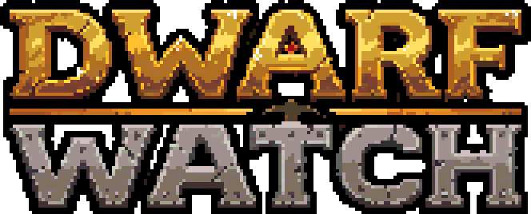
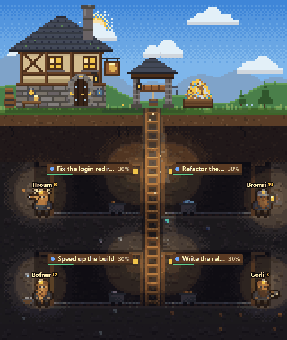

<p align="center"></p>

A little pixel-art dwarven mine that shows what your Claude Code sessions are doing.



Each running Claude Code session is a dwarf digging its own tunnel; subagents are gnomes that come down
to help. You can see at a glance which sessions are working, which have finished, and which are waiting
for you (their dwarf climbs up to the surface with a green "!").

## What it shows

- **Sessions as dwarves.** The tunnel grows with the session's tool calls. The dwarf's animation follows
  what it is doing: a lantern for reading, hammer and chisel for edits, an ore cart for shell commands, a
  spyglass for web and browser tools, a wave when it calls in subagents, a pickaxe for everything else.
- **Subagents as gnomes,** dressed by type: explorers dig, general-purpose helpers carry a lantern,
  planners carry a sack.
- **Subsessions in side shafts.** A session started by another running session (a "New task" in the
  desktop app) gets its gallery under its parent's, reached by its own ladder down from the parent's
  gallery; its ore climbs that ladder to the windlass.
- **The model by its pickaxe:** wood, copper, iron, gold or diamond, by the model's price.
- **Context** per session on its tunnel sign: how full the context window is, with a coloured bar.
- **Plan usage:** an estimate of your 5-hour and weekly limits (see below).
- **A crew that grows.** Dwarves are kept in a roster: free dwarves take new sessions (preferring ones
  that know the project), earn XP per tool call, level up (with fireworks), and can be renamed and
  restyled in the tavern.
- **Ore.** Mined ore fills each tunnel's cart; full carts are hauled up by the windlass onto an ore store
  that grows over time. No ore is lost to restarts or closed sessions.
- **Day and night** follow your working hours (set them with the ☀ button), with sunrise, sunset and a
  moon.
- **Click a dwarf or a sign** to open that session in the Claude desktop app.

## Download (Windows)

1. Install [Node.js](https://nodejs.org) 18 or later, if you don't have it.
2. Download `Dwarfwatch-…-win-x64.zip` from the [latest release](https://github.com/MtnGoatDK/dwarfwatch/releases/latest)
   and unzip it anywhere.
3. Run `Dwarfwatch.exe`. It opens the mine in a small always-on-top window and starts its server itself.

Use Claude Code on the same computer (the desktop app or the CLI) and your sessions appear as dwarves.
The exe includes .NET, so nothing else needs installing. It isn't code-signed, so Windows SmartScreen
may ask you to confirm the first time (More info → Run anyway). Set your working hours with the ☀
button.

## Running it from source

Requirements: [Node.js](https://nodejs.org) 18 or later, and Claude Code on the same machine.

```
node server.js
```

Then open <http://localhost:4777>. The page lists the sessions as cards under the mine; **Pop out** puts
the mine in a small always-on-top window (Chrome).

### The desktop overlay (Windows)

`overlay/` is a small borderless, always-on-top window (WinForms + WebView2) that shows just the mine.
It snaps to screen edges and corners, remembers where you put it, and starts the server itself if
nothing is running on the port.

Requirements: the .NET 10 SDK and the WebView2 runtime (part of current Windows).

```
cd overlay
dotnet publish -c Release -o app
app\Dwarfwatch.exe
```

Drag it by its top bar; hold **Alt** while dragging to place it without snapping.

## How it works

`server.js` (no dependencies) reads Claude Code's own local files:

- `~/.claude/sessions/*.json`, the running sessions and whether each is busy or idle;
- each session's transcript (`~/.claude/projects/...jsonl`), read incrementally, for the model, tool
  calls, tokens, the last prompt and whether the last reply asked you something;
- the subagent transcripts next to it, for the gnomes;
- the Claude desktop app's own metadata for each session
  (`%LOCALAPPDATA%\Claude-Data\…\claude-code-sessions\…\local_….json`), only for which session started
  which (`spawnedFrom`). That file is not documented and has only been seen on Windows; without it
  every session is simply its own gallery off the main shaft.

It serves the page and a small JSON API on `127.0.0.1` only. `mine.js` is the canvas engine that draws
the mine; `index.html` is the page and the overlay's UI.

Opening a session in the Claude desktop app uses the app's `claude://code/continue?session=...` link.
That link is not documented, so an app update could change it.

### Plan usage (an estimate)

The usage meters are worked out from the token use in your local transcripts, scaled to match numbers
you read off the Claude app once. Copy `usage-calibration.example.json` to `usage-calibration.json` and
fill in the 5-hour and weekly percentages and reset times the app shows you at a given moment. Without
that file the meters are hidden. Usage from other devices or claude.ai in a browser is not included, so
the estimate drifts over time; update the file now and then.

### Your data

Everything stays on your machine. The overlay keeps its window position, and the server keeps the dwarf
roster, the ore and your day-and-night hours, in `%LOCALAPPDATA%\Dwarfwatch\` (`~/.local/share/Dwarfwatch`
elsewhere). It used to be called Agent Watch; data in an old `AgentWatch` folder is copied over on first
start, and the old `AGENT_WATCH_*` settings below still work.

### Re-recording the demo

`tools/demo/` plays a scripted story (fake sessions, nothing of yours) on a virtual clock and records
every frame: `python tools/demo/serve.py`, open <http://127.0.0.1:4790/?overlay=1#rec> at about
480 × 680, wait for `tools/demo/done.txt` (around 30 seconds), then `python tools/demo/make_gif.py` to
write `demo.gif` (needs Pillow).

### Settings

| Variable | Default | |
| --- | --- | --- |
| `PORT` | `4777` | the server's port |
| `CLAUDE_CONFIG_DIR` | `~/.claude` | where Claude Code keeps its sessions and transcripts |
| `DWARFWATCH_ROSTER` | `%LOCALAPPDATA%\Dwarfwatch\roster.json` | the dwarf roster and ore file |
| `CONTEXT_WINDOW` | `1000000` | the context window size the tunnel signs measure against |
| `DWARFWATCH_PORT` | `4777` | the port the overlay app connects to |
| `DWARFWATCH_SERVER` | found next to the app | the `server.js` the overlay app starts when none is running |
